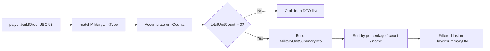

# Requirements

### Overview & Goals
Filter out military units with zero production from the `PlayerSummaryDto.militaryProduction` response list so that only units actually produced across analyzed games are returned to the client and displayed in the UI.

### Scope
- **In Scope**:
  - Updating `PlayerSummaryAnalysisService.calculateMilitarySummary` to filter out any tracked military units where `totalUnitCount <= 0.0`.
  - Updating existing unit test assertions in `PlayerSummaryAnalysisServiceTest` to verify that only produced units are present in `summary.getMilitaryProduction()`.
  - Adding test coverage verifying that unproduced units are excluded and that games with zero military production yield an empty military production list.
- **Out of Scope**:
  - Modifying the catalog of tracked military units in `TRACKED_MILITARY_UNITS`.
  - Modifying non-military summaries (villagers, traders, town centers, landmarks).
  - Database schema or API contract changes to `MilitaryUnitSummaryDto`.

### User Stories
- As an Age of Empires IV player/analyst, I want the player summary UI to show only the military units that the player actually produced rather than all 65 tracked units with 0.0 values, so that I can quickly assess their real army composition without clutter.

### Functional Requirements
1. **Zero-Production Unit Filtering**:
   - `PlayerSummaryAnalysisService.calculateMilitarySummary` must only include units in `results` if `totalUnitCount > 0` (i.e. at least one unit was produced in at least one analyzed game).
   - If a tracked unit was never produced (`totalUnitCount == 0`), it must be omitted from `summary.getMilitaryProduction()`.
2. **Preservation of Metrics & Sorting**:
   - For all produced units, continue calculating average counts per age (Dark, Feudal, Castle, Imperial), total average count across games, and percentage of total military production.
   - Retain sorting order: highest percentage descending, highest average count descending, then unit type ascending.
3. **Empty Production Handling**:
   - When no military units are produced in any analyzed game, `summary.getMilitaryProduction()` must return an empty list (`[]`).

### Non-Functional Requirements
- Java 21 conventions: explicit typing, final parameters and variables, Lombok builders, and all existing test suites passing.

# Technical Design

### Current Implementation
- `PlayerSummaryAnalysisService.calculateMilitarySummary` iterates over all 65 units in `TRACKED_MILITARY_UNITS`:
  ```java
  for (final String unitType : TRACKED_MILITARY_UNITS) {
      final double[] counts = unitCounts.get(unitType);
      final double darkAvg = round(counts[0] / totalGames);
      final double feudalAvg = round(counts[1] / totalGames);
      final double castleAvg = round(counts[2] / totalGames);
      final double imperialAvg = round(counts[3] / totalGames);
      final double totalUnitCount = counts[0] + counts[1] + counts[2] + counts[3];
      final double totalAvg = round(totalUnitCount / totalGames);
      final double percentage = totalAllMilitary > 0.0
              ? round((totalUnitCount / totalAllMilitary) * 100.0)
              : 0.0;

      results.add(MilitaryUnitSummaryDto.builder()
              .withUnitType(unitType)
              ...
              .build());
  }
  ```
- Because every unit in `TRACKED_MILITARY_UNITS` is added regardless of `totalUnitCount`, `summary.getMilitaryProduction()` always produces 65 items even if only 2–3 units were built.

### Key Decisions
1. **Omit Zero Counts in Iteration**:
   - Check `totalUnitCount <= 0.0` inside `calculateMilitarySummary` loop and `continue` to skip unproduced units.
   - This optimizes performance by skipping unnecessary rounding and DTO construction for unused units while directly satisfying the UI requirement.

### Proposed Changes
- In `src/main/java/com/theboys/aoe/opp/info/service/PlayerSummaryAnalysisService.java`:
  - In `calculateMilitarySummary`:
    ```java
    for (final String unitType : TRACKED_MILITARY_UNITS) {
        final double[] counts = unitCounts.get(unitType);
        final double totalUnitCount = counts[0] + counts[1] + counts[2] + counts[3];
        if (totalUnitCount <= 0.0) {
            continue;
        }

        final double darkAvg = round(counts[0] / totalGames);
        final double feudalAvg = round(counts[1] / totalGames);
        final double castleAvg = round(counts[2] / totalGames);
        final double imperialAvg = round(counts[3] / totalGames);
        final double totalAvg = round(totalUnitCount / totalGames);
        final double percentage = totalAllMilitary > 0.0
                ? round((totalUnitCount / totalAllMilitary) * 100.0)
                : 0.0;

        results.add(MilitaryUnitSummaryDto.builder()
                .withUnitType(unitType)
                .withAverageCount(totalAvg)
                .withPercentageOfTotal(percentage)
                .withDarkAge(darkAvg)
                .withFeudalAge(feudalAvg)
                .withCastleAge(castleAvg)
                .withImperialAge(imperialAvg)
                .build());
    }
    ```

### Architecture Diagram


### File Structure
- Modified:
  - `src/main/java/com/theboys/aoe/opp/info/service/PlayerSummaryAnalysisService.java`
- Tests Modified:
  - `src/test/java/com/theboys/aoe/opp/info/service/PlayerSummaryAnalysisServiceTest.java`

### Risks
- **Risk**: Existing unit tests assert `military.size() == 65` and check unproduced units (`assertEquals(0.0, horseman.getAverageCount())`).
  - **Mitigation**: Update test fixtures in `PlayerSummaryAnalysisServiceTest` to assert expected filtered list sizes and verify unproduced units are not in the result map.

# Testing

### Validation Approach
Automated JUnit 5 unit tests verifying that only produced military units are included in `summary.getMilitaryProduction()`.

### Key Scenarios
1. **Single and Multi-Game Production Filtering**:
   - Games with a subset of military units (e.g. Peter with 9 unit types, GSUGambit with 12 unit types, TwoGames fixture with 3 unit types) return exactly that number of items in `militaryProduction`.
2. **Zero Military Production**:
   - Games with only villagers/buildings and no military units return an empty list (`militaryProduction.isEmpty()`).
3. **Exclusion of Unproduced Units**:
   - Verify `milMap.containsKey("unproducedUnit")` is false for units not built in the match.

### Test Changes
- Update `PlayerSummaryAnalysisServiceTest.java`:
  - `analyzePlayerSummaries_SingleGame_Peter`: assert `military.size()` is 9.
  - `analyzePlayerSummaries_SingleGame_GSUGambit`: assert `military.size()` is 12.
  - `analyzePlayerSummaries_TwoGames_AggregatedAverages`: assert `military.size()` is 3 (spearman, knight, manatarms), replace assertions for unbuilt `horseman` and `archer` with `assertNull(milMap.get("horseman"))` and `assertNull(milMap.get("archer"))`.
  - `analyzePlayerSummaries_ExpandedMilitaryUnits_AllCategoriesAndPrecedence`: assert `military.size()` is 18, assert unproduced `spearman` is null (`assertNull(milMap.get("spearman"))`).
  - Add test `analyzePlayerSummaries_ZeroMilitaryProduction_ReturnsEmptyList()`.

# Delivery Steps

### ✓ Step 1: Filter Out Zero-Production Military Units in PlayerSummaryAnalysisService
Update military summary calculation in PlayerSummaryAnalysisService to exclude units with zero total production.

- In `PlayerSummaryAnalysisService.java`, check `totalUnitCount <= 0.0` in `calculateMilitarySummary` and skip unproduced units.
- Ensure only units with at least one build event across analyzed games are added to the returned `MilitaryUnitSummaryDto` list.

### ✓ Step 2: Update and Add Test Cases in PlayerSummaryAnalysisServiceTest
Update existing test fixtures and add dedicated test coverage for zero-production filtering in PlayerSummaryAnalysisServiceTest.

- Update list size assertions in `analyzePlayerSummaries_SingleGame_Peter` (9), `analyzePlayerSummaries_SingleGame_GSUGambit` (12), `analyzePlayerSummaries_TwoGames_AggregatedAverages` (3), and `analyzePlayerSummaries_ExpandedMilitaryUnits_AllCategoriesAndPrecedence` (18).
- Update unproduced unit assertions to verify unproduced units are absent from the returned military production list.
- Add test `analyzePlayerSummaries_ZeroMilitaryProduction_ReturnsEmptyList` to verify empty list handling when no military units are built.
- Execute `./gradlew test` to ensure all tests pass.