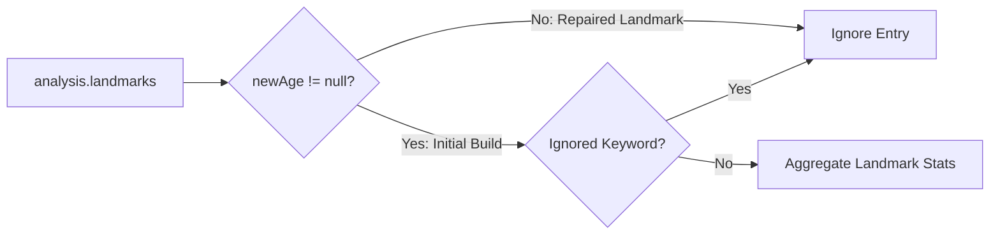

# Requirements

### Overview & Goals
Filter out repaired / rebuilt landmarks from the landmark analysis in `PlayerSummaryAnalysisService`. In AOE4 match data, when a destroyed landmark is repaired or rebuilt, an entry is logged in `analysis.landmarks` with a null `newAge` parameter. Excluding entries where `newAge` is null ensures landmark pick rates, timings, and age transitions reflect only genuine initial landmark constructions and provide accurate strategic insights.

### Scope
- **In Scope**:
  - Updating `PlayerSummaryAnalysisService.calculateLandmarkSummaries` to ignore any landmark node where `newAge` is null or missing.
  - Updating `PlayerSummaryAnalysisService.playerReachedAge` and `extractLandmarkTargetAge` to only recognize genuine age-up landmarks with valid `newAge` values.
  - Adding unit test scenarios in `PlayerSummaryAnalysisServiceTest` to verify that repaired landmark entries (with `"newAge": null` or absent `newAge`) are excluded from landmark statistics and age-reach calculations.
- **Out of Scope**:
  - Modifying the DTO structures (`LandmarkSummaryDto`, `PlayerSummaryDto`, etc.).
  - Altering military, villager, APM, or Town Center metric calculations.

### User Stories
- As an Age of Empires IV analyst, I want repaired or rebuilt landmarks to be excluded from landmark metrics so that landmark pick counts, average timings, and pick rates only reflect initial construction choices.

### Functional Requirements
1. **Repaired Landmark Exclusion**:
   - In `analysis.landmarks`, inspect the `newAge` attribute of each landmark entry.
   - If `newAge` is null or missing (i.e. `!lmNode.hasNonNull("newAge")`), treat the landmark entry as a repair/rebuild event and exclude it from landmark aggregation.
2. **Age Reach Determination**:
   - When determining whether a player reached Age 2, 3, or 4 via built landmarks in `playerReachedAge`, ignore any landmark entry with a null/missing `newAge`.
3. **Landmark Aggregation & Metrics**:
   - Aggregate only initial landmark constructions with non-null `newAge` for `timesBuilt`, `averageGameTimeSeconds`, `targetAge`, and `pickRatePercentage`.

### Non-Functional Requirements
- Adhere to codebase standards: explicit typing (no `var`), `final` modifiers on local variables and parameters, immutability preference, and clean handling of Jackson JSON nodes.

# Technical Design

### Current Implementation
In `PlayerSummaryAnalysisService`:
- `calculateLandmarkSummaries` loops through `analysis.get("landmarks")` and checks `isIgnoredLandmark(name)`. If a landmark is repaired later in the game, an entry with `"newAge": null` may be present in `analysis.landmarks`.
- `extractLandmarkTargetAge` checks `lmNode.hasNonNull("newAge")` and falls back to `minAge + 1`.
- If an entry has `"newAge": null`, it could either be recorded or influence earliest timestamp lookups.

### Key Decisions
1. **Filter by `newAge` nullness in Landmark Aggregation**:
   - In `calculateLandmarkSummaries`, immediately skip landmark entries that lack a non-null `newAge`:
     ```java
     if (!lmNode.hasNonNull("newAge")) {
         continue;
     }
     ```
   - This cleanly eliminates repaired/rebuilt landmarks and non-age-up structures before tracking earliest timestamps or updating aggregators.
2. **Filter by `newAge` nullness in Age Reach Checks**:
   - In `playerReachedAge`, similarly skip landmark entries where `!lmNode.hasNonNull("newAge")` to ensure repaired landmarks without age-up connotations do not falsely signal reaching a higher age.
3. **Strict Target Age Extraction**:
   - In `extractLandmarkTargetAge`, extract `newAge` when non-null (`lmNode.hasNonNull("newAge") ? lmNode.get("newAge").asInt() : null`) and return `null` otherwise.

### File Structure
- Modified:
  - `src/main/java/com/theboys/aoe/opp/info/service/PlayerSummaryAnalysisService.java`
- Tests Modified:
  - `src/test/java/com/theboys/aoe/opp/info/service/PlayerSummaryAnalysisServiceTest.java`

### Architecture Diagram


### Risks & Mitigations
- **Risk**: A valid landmark might omit `newAge` in some anomalous payload.
  - **Mitigation**: In AOE4World data structures, landmark age-ups always include integer `newAge` (2, 3, or 4), whereas rebuild/repair events have `newAge: null`.

# Testing

### Validation Approach
Verify filtering of repaired landmarks with JUnit 5 unit tests in `PlayerSummaryAnalysisServiceTest` using both synthetic payloads and sample match fixtures.

### Key Scenarios
1. **Repaired Landmark Exclusion**:
   - Provide a player node with an initial landmark build (`gameTime: 300, newAge: 2`) and a subsequent repair event (`gameTime: 900, newAge: null`).
   - Verify `timesBuilt` is 1, `averageGameTimeSeconds` is 300.0, and `pickRatePercentage` is 100.0%.
2. **Standalone Rebuilt Landmark with No New Age**:
   - Provide a landmark entry where only `newAge: null` exists.
   - Verify that this landmark is excluded from `landmarks` list entirely and does not contribute to age-reach counts.
3. **Regression Suite**:
   - Execute existing tests (`peter1057285`, `GSUGambit`, Knights Templar match) to ensure valid landmark summaries remain intact.

# Delivery Steps

### ✓ Step 1: Filter out landmarks with null newAge in PlayerSummaryAnalysisService
PlayerSummaryAnalysisService ignores all landmark entries with null or missing newAge, excluding repaired landmarks from analysis and age-reach evaluation.

- Update `calculateLandmarkSummaries` to bypass landmark entries where `!lmNode.hasNonNull("newAge")`.
- Update `playerReachedAge` to ignore landmark nodes without a non-null `newAge`.
- Simplify `extractLandmarkTargetAge` to strictly extract `newAge` from non-null nodes.

### ✓ Step 2: Add unit tests for repaired landmark filtering and verify test suite
Unit test suite verifies that repaired landmark entries with null newAge are ignored without affecting genuine landmark statistics.

- Add unit test in `PlayerSummaryAnalysisServiceTest` with initial and repaired landmark events to verify build times, pick counts, and pick rates.
- Update/add test fixtures to ensure standalone null `newAge` entries are omitted from results.
- Run `./gradlew test` to ensure all tests pass cleanly.