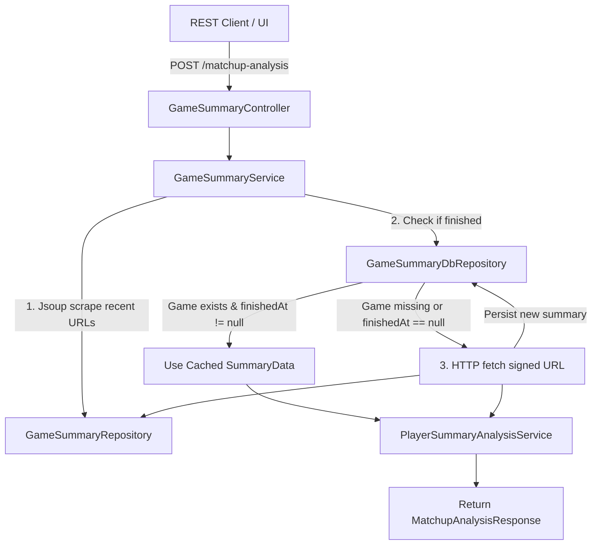

# Requirements

### Overview & Goals
Optimize the `POST /api/v1/aoe4-opp/game-summary/matchup-analysis` (`scrapeMatchup`) endpoint by eliminating redundant HTTP calls to AOE4World for game summaries that are already stored in the local PostgreSQL database with a completed status (`finishedAt != null`).

### Scope
- **In Scope**:
  - Keep the initial Jsoup call to fetch the player's recent games page to discover recent match IDs and signed URLs.
  - Check the database (`game_summary` table via `GameSummaryDbRepository`) for each discovered match ID.
  - If a match is found in the database and has a non-null `finishedAt` value in `summaryData`, bypass the signed URL HTTP call and use the cached summary JSON.
  - If a match is not found or is unfinished (`finishedAt` is null), fetch the summary JSON via HTTP and persist it to the database.
  - Refactor `GameSummaryRepository` and `GameSummaryService` to support this cache-aside flow cleanly.
  - Update and add unit tests in `GameSummaryRepositoryTest` and `GameSummaryServiceTest`.
- **Out of Scope**:
  - Modifying the external API contracts or DTOs returned by `scrapeMatchup`.
  - Database schema changes (the existing `summary_data` JSONB column already holds `finishedAt`).
  - Caching the Jsoup player profile page scrape (the Jsoup call is required to discover the player's latest matches).

### User Stories
- As an AoE4 Opponent Info user, I want the matchup analysis endpoint to quickly return analysis using cached game summaries for already finished games, so that repeated matchup requests and page reloads are fast and do not make unnecessary external HTTP calls.

### Functional Requirements
- **Matchup Discovery**: The initial Jsoup scrape on the player's profile page must execute to obtain the latest match IDs and signed URLs for the requested leaderboard and civilization.
- **Cache Check**: For each discovered game ID, check if a record exists in `game_summary`.
- **Finished Game Detection**: A game is considered finished if `summaryData` in `GameSummaryDao` is non-null and contains a non-null `finishedAt` property (`summaryData.hasNonNull("finishedAt")`).
- **Conditional HTTP Fetch**:
  - If finished in DB: Skip the external HTTP call to AOE4World signed URL; use the cached `summaryData`.
  - If missing from DB or not finished (`finishedAt` is null): Execute HTTP GET to fetch the summary JSON, parse it, persist/update it in `game_summary`, and use it in analysis.
- **Response Consistency**: The returned `MatchupAnalysisResponse` must maintain identical structure and accurate metrics regardless of whether summaries were loaded from DB or fetched via HTTP.

### Non-Functional Requirements
- **Performance**: Significant reduction in latency for `scrapeMatchup` when opponent match history contains previously scraped finished games.
- **Code Standards**: Strict adherence to project guidelines (immutability, `final` parameters/variables, Lombok `@RequiredArgsConstructor` and `@Slf4j`, early returns, no magic strings).

# Technical Design

### Current Implementation
- `GameSummaryRepository.scrapePlayerGames(...)` currently fetches the HTML page with Jsoup, extracts up to `limit` signed game URLs, and immediately executes HTTP requests to AOE4World for each signed URL within a loop.
- `GameSummaryService.scrapeMatchup(...)` invokes `scrapePlayerGames(...)`, then iterates through all returned `ScrapedGameSummary` items to persist them into `GameSummaryDbRepository` and build `summaryNodes` for `PlayerSummaryAnalysisService`.
- If a match has already been scraped and persisted, `scrapeMatchup` still re-fetches the summary via HTTP every time before saving over the existing DAO record.

### Key Decisions
- **Service-Level Cache Orchestration**: Keep `GameSummaryRepository` focused on HTTP/Jsoup extraction without direct database coupling. `GameSummaryService` coordinates between `GameSummaryRepository` (for URL discovery and individual game summary fetching) and `GameSummaryDbRepository` (for DB lookups and persistence).
- **Finished State Validation**: Use `summaryData != null && summaryData.hasNonNull("finishedAt")` on `GameSummaryDao` to check if a match is finished. Once finished, match state is immutable.
- **Granular Repository Methods**: Expose `scrapeRecentGameUrls(...)` on `GameSummaryRepository` to retrieve `Map<String, String>` (mapping `gameId` -> `signedUrl`) so the service layer can inspect each `gameId` before deciding whether to call `fetchGameSummaryJson(...)`.

### Proposed Changes
1. **`GameSummaryRepository`**:
   - Add `scrapeRecentGameUrls(final String profileId, final String gamerName, final String civilization, final String leaderboard, final Integer limit)` returning `Map<String, String>` (ordered `LinkedHashMap` of `gameId` to `signedUrl`).
   - Keep `fetchGameSummaryJson(final HttpClient client, final String signedGameUrl)` accessible or add `fetchGameSummaryJson(final String signedGameUrl)`.
   - Update `scrapePlayerGames` to delegate to `scrapeRecentGameUrls` and `fetchGameSummaryJson` for backward compatibility.
2. **`GameSummaryService`**:
   - In `scrapeMatchup(...)`, call `gameSummaryRepository.scrapeRecentGameUrls(...)`.
   - For each entry (`gameId`, `signedUrl`), check `gameSummaryDbRepository.findByGameId(gameId)`.
   - If present and `dao.getSummaryData() != null && dao.getSummaryData().hasNonNull("finishedAt")`:
     - Add `gameId` to `gameIds` and `dao.getSummaryData()` to `summaryNodes`.
     - Log debug/info indicating DB cache hit for finished game.
   - Otherwise:
     - Fetch raw JSON via `gameSummaryRepository.fetchGameSummaryJson(signedUrl)`.
     - Parse JSON into `JsonNode`, call `persistGameSummary(...)`, and add to `gameIds` and `summaryNodes`.
   - Complete player analysis via `playerSummaryAnalysisService.analyzePlayerSummaries(...)`.

### Architecture Diagram

### Risks & Mitigations
- **Edge Case: In-progress Games**: An active game may have `finishedAt == null` initially. When re-scraped later, it must trigger the HTTP fetch and update the DB record once it concludes. Mitigation: Only treat games as cached when `hasNonNull("finishedAt")` is true.
- **Network / Parse Failures**: If an individual HTTP fetch fails for an uncached game, gracefully log warning and continue processing remaining games without failing the whole request.

# Testing

### Validation Approach
Verify the caching and scraping behavior using automated JUnit 5 unit tests with Mockito mocks for repository and service layers.

### Key Scenarios
- **Scenario 1: Full DB Cache Hit (All games finished)**
  - Jsoup returns 10 signed URLs.
  - All 10 game IDs exist in `gameSummaryDbRepository` with `summaryData` having `"finishedAt": 123456789`.
  - Verify `fetchGameSummaryJson` is NEVER called.
  - Verify all 10 summary nodes are passed to `playerSummaryAnalysisService.analyzePlayerSummaries`.
- **Scenario 2: Full Cache Miss (No games in DB)**
  - Jsoup returns signed URLs for new game IDs not in `gameSummaryDbRepository`.
  - Verify HTTP fetch is performed for all games and saved via `persistGameSummary`.
- **Scenario 3: Partial Cache Hit / Mixed**
  - Some games already exist with `finishedAt != null`, while others are new or have `finishedAt == null`.
  - Verify HTTP fetch is only called for the uncached/unfinished games.
  - Verify analysis combines both cached and freshly scraped summaries in correct order.
- **Scenario 4: Graceful Degradation on Individual Scrape Failure**
  - If an uncached game fails to fetch or parse, verify error is logged and valid cached/fetched games are processed.

### Test Changes
- `GameSummaryServiceTest`: Add tests for full cache hit, partial cache hit, unfinished game re-fetch, and verify `gameSummaryRepository` method invocations.
- `GameSummaryRepositoryTest`: Add unit tests for `scrapeRecentGameUrls` verifying URL filtering, limit capping, and game ID extraction.

# Delivery Steps

### ✓ Step 1: Refactor GameSummaryRepository for granular game URL and summary fetching
Update `GameSummaryRepository` to cleanly separate recent game URL extraction (via Jsoup) from game summary HTTP downloads.

- Add a method (e.g., `scrapeRecentGameUrls`) in `GameSummaryRepository` that performs the Jsoup call to the player's games page and returns a map or list of game IDs to their signed URLs up to the specified limit.
- Ensure `fetchGameSummaryJson` (or a dedicated single-game fetch method) is accessible for fetching individual game summaries by signed URL.
- Maintain or adapt `scrapePlayerGames` to reuse these methods for backward compatibility.
- Ensure all method parameters and local variables are marked `final`.

### ✓ Step 2: Implement database cache check in GameSummaryService.scrapeMatchup
Integrate database cache lookup into `GameSummaryService.scrapeMatchup` to bypass external HTTP calls for completed games.

- Retrieve recent game IDs and signed URLs for each player using `GameSummaryRepository.scrapeRecentGameUrls`.
- For each discovered `gameId`, query `GameSummaryDbRepository.findByGameId(gameId)` (or batch lookup).
- Check if the existing record contains a non-null `finishedAt` timestamp in its `summaryData`.
- If the game is already in the database and finished, reuse the existing `JsonNode` summary directly without making an HTTP request.
- If the game is not present or `finishedAt` is null/missing, execute the HTTP fetch via `GameSummaryRepository`, parse the JSON, persist or update via `persistGameSummary`, and use the freshly fetched summary.
- Pass the resolved `summaryNodes` and `gameIds` to `PlayerSummaryAnalysisService.analyzePlayerSummaries` as before.

### ✓ Step 3: Update and add unit tests for caching and scraping behavior
Update existing tests and add comprehensive unit test scenarios for database cache hits and misses in `scrapeMatchup`.

- Update `GameSummaryRepositoryTest` with unit tests for `scrapeRecentGameUrls` and URL extraction behavior.
- Update `GameSummaryServiceTest` to verify that when a game exists in the database with a non-null `finishedAt`, no HTTP call is made for that game and its cached summary is used.
- Add test cases in `GameSummaryServiceTest` verifying scenarios where a game is in the database with `finishedAt == null` (triggering an HTTP fetch and update), when games are completely missing from the database, and mixed scenarios with partial cache hits.