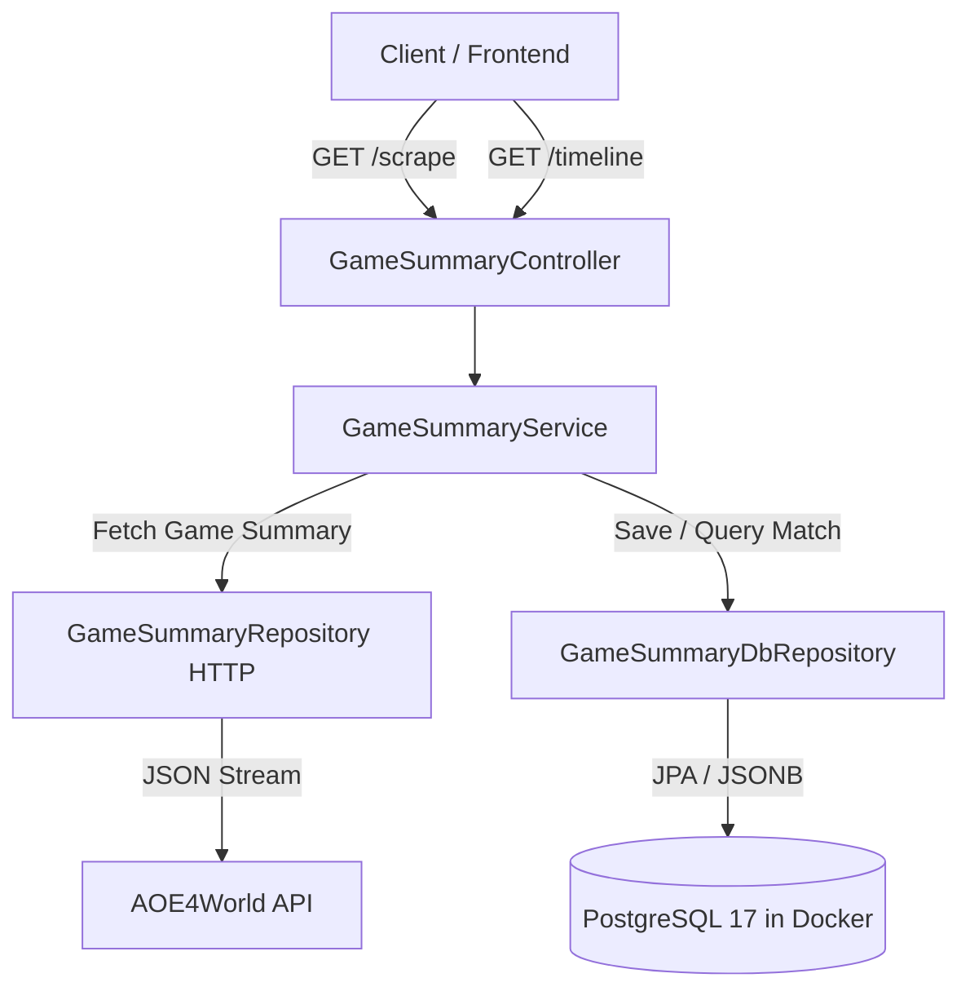

# Requirements

### Overview & Goals
Transition game summary storage from transient local disk files (`matches/match_*.json`) to a Docker-hosted PostgreSQL database using native `JSONB`. This maximizes utility by leveraging the existing PostgreSQL 17 service in Docker Compose, ensuring durable persistence, low operational friction, and high analytical flexibility for charting villager and military production speed.

### Scope
- **In Scope**:
  - Configuring Spring Data JPA, PostgreSQL driver, and Flyway migrations in `build.gradle` and application configuration.
  - Creating the `game_summary` database table with `JSONB` payload storage and GIN indexing for fast querying.
  - Creating `GameSummaryDao` and `GameSummaryDbRepository` adhering to project conventions.
  - Refactoring `GameSummaryRepository` and `GameSummaryService` to persist game summaries directly to PostgreSQL instead of saving files to disk.
  - Adding DTOs and query endpoints to extract and return timeline production metrics (villager and military counts over time) for charting.
- **Out of Scope**:
  - Frontend chart rendering components.
  - Provisioning secondary database containers (e.g., MongoDB, Redis).
  - Asynchronous message broker infrastructure (Kafka / RabbitMQ).

### User Stories
- As a developer, I want match timeline data saved directly to PostgreSQL with `JSONB` so that matches are durably stored without managing flat files on disk.
- As a frontend consumer, I want an API endpoint to retrieve player production timelines (villagers and military over game duration) so that I can render comparative charts and graphs.
- As a system maintainer, I want automated Flyway schema migrations so that database setup is reproducible across development and containerized environments.

### Functional Requirements
- **FR-1**: The system must automatically apply Flyway database migrations on startup to create the `game_summary` table with necessary indexes.
- **FR-2**: When scraping a game summary, the service must store the raw JSON payload along with metadata (`game_id`, `profile_id`, `gamer_name`, `leaderboard`, `created_at`, `updated_at`) in PostgreSQL.
- **FR-3**: Persistence must be idempotent: scraping an existing `game_id` updates the existing record rather than failing on unique constraint violations.
- **FR-4**: An endpoint `GET /api/v1/aoe4-opp/game-summary/{gameId}` must return the exact stored raw match summary JSON without Jackson JavaBean serialization wrappers or metadata corruption.
- **FR-5**: An endpoint `GET /api/v1/aoe4-opp/game-summary/{gameId}/timeline` must return parsed time-series data points (timestamp, villager count, military count, total population) calculated from player `resources.timestamps` and `buildOrder` event logs.

### Non-Functional Requirements
- **Performance**: Use PostgreSQL GIN indexes on JSONB fields for rapid sub-document queries and high-throughput ingestion.
- **Resource Efficiency**: Maximize utility and minimize container footprint by utilizing the already configured PostgreSQL 17 container in `docker-compose.yml`.
- **Maintainability**: Follow project architectural patterns (final parameters, `@RequiredArgsConstructor`, `@Transactional` services, separation of DAO and DTO layers).

# Technical Design

### Current Implementation
- `GameSummaryRepository` fetches match summary JSON from `https://aoe4world.com/players/{profileId}/games` and saves raw JSON to PostgreSQL with JSONB mapping.
- `GameSummaryController.getGameSummary` currently returns `com.fasterxml.jackson.databind.JsonNode`, which causes Spring Boot 4's web serializer to serialize the `JsonNode` class getters (`isArray`, `isContainerNode`, `isObject`, etc.) rather than the underlying JSON document.
- `GameSummaryService.extractDataPoints` looks for nonexistent array fields (`intervals`, `timeline`, `states`, `series`) on player objects, resulting in empty `dataPoints: []` because AOE4World game summaries store time-series data under `resources.timestamps` and unit event timestamps under `buildOrder[*].finished` / `buildOrder[*].destroyed`.

### Key Decisions
- **Raw JSON String Serialization for Match Summary Endpoint**: `GameSummaryController.getGameSummary` and `GameSummaryService.getGameSummary` return `String` (or `ResponseEntity<String>`) with `produces = MediaType.APPLICATION_JSON_VALUE` to return the pristine JSON document without version-mismatched Jackson POJO conversion overhead.
- **Build-Order & Timestamp Event Processing for Timeline Metrics**: Accurately calculate active villager counts, military counts, and population at each interval `t` in `player.resources.timestamps` by aggregating cumulative finished units minus destroyed units from `player.buildOrder`.
- **PostgreSQL JSONB over Secondary Document Store**: Utilizing the existing PostgreSQL 17 container maximizes net utility by eliminating multi-database overhead while providing complete schema flexibility and GIN-indexed querying for large timeline JSON documents.
- **Spring Data JPA with `@JdbcTypeCode(SqlTypes.JSON)`**: Direct JSON mapping into `JsonNode` eliminates manual serialization glue code and ensures type safety.
- **Direct Synchronous Persistence**: Scraping directly persists payloads in the request lifecycle, ensuring immediate data consistency with minimal architectural complexity.

### Proposed Changes
- **Fix Game Summary Raw Payload Endpoint**:
  - Update `GameSummaryService.getGameSummary` to return the JSON string or `summaryData.toString()`.
  - Update `GameSummaryController.getGameSummary` to return `String` / `ResponseEntity<String>` with `produces = "application/json"`.
- **Implement Accurate Timeline Metric Parsing**:
  - In `GameSummaryService.parseTimelineMetrics`, parse top-level `players` array.
  - For each player:
    - Extract `profileId`, `name`, `civilization`, and `result`.
    - Retrieve `resources.timestamps` array (e.g., `[0, 20, 40, 60, ...]`).
    - Parse `buildOrder` items into villager unit events (`icon` contains `villager` or civ variants like `gilded_villager`) and military unit events (`type == "Unit"` and non-villager).
    - For each timestamp `t`:
      - `villagerCount = Math.max(0, finishedVillagers(<= t) - destroyedVillagers(<= t))`
      - `militaryCount = Math.max(0, finishedMilitary(<= t) - destroyedMilitary(<= t))`
      - `totalPopulation = villagerCount + militaryCount`
    - Construct `TimelineDataPointDto` instances per timestamp step and assemble into `PlayerTimelineDto`.
  - Maintain defensive fallbacks for alternative or legacy schema layouts.

### Data Models / Contracts

#### Database Schema (`V1__create_game_summary_table.sql`)
```sql
CREATE TABLE IF NOT EXISTS game_summary (
    game_id VARCHAR(64) PRIMARY KEY,
    profile_id VARCHAR(64),
    gamer_name VARCHAR(128),
    leaderboard VARCHAR(64),
    summary_data JSONB NOT NULL,
    created_at TIMESTAMP WITH TIME ZONE DEFAULT CURRENT_TIMESTAMP,
    updated_at TIMESTAMP WITH TIME ZONE DEFAULT CURRENT_TIMESTAMP
);

CREATE INDEX IF NOT EXISTS idx_game_summary_profile_id ON game_summary (profile_id);
CREATE INDEX IF NOT EXISTS idx_game_summary_leaderboard ON game_summary (leaderboard);
CREATE INDEX IF NOT EXISTS idx_game_summary_data_gin ON game_summary USING gin (summary_data jsonb_path_ops);
```

#### DAO Entity (`GameSummaryDao.java`)
```java
package com.theboys.aoe.opp.info.dao;

import com.fasterxml.jackson.databind.JsonNode;
import jakarta.persistence.Column;
import jakarta.persistence.Entity;
import jakarta.persistence.Id;
import jakarta.persistence.Table;
import lombok.Getter;
import lombok.Setter;
import org.hibernate.annotations.JdbcTypeCode;
import org.hibernate.type.SqlTypes;

import java.time.OffsetDateTime;

@Getter
@Setter
@Entity
@Table(name = "game_summary")
public class GameSummaryDao {

    @Id
    @Column(name = "game_id", nullable = false, length = 64)
    private String gameId;

    @Column(name = "profile_id", length = 64)
    private String profileId;

    @Column(name = "gamer_name", length = 128)
    private String gamerName;

    @Column(name = "leaderboard", length = 64)
    private String leaderboard;

    @JdbcTypeCode(SqlTypes.JSON)
    @Column(name = "summary_data", nullable = false, columnDefinition = "jsonb")
    private JsonNode summaryData;

    @Column(name = "created_at")
    private OffsetDateTime createdAt;

    @Column(name = "updated_at")
    private OffsetDateTime updatedAt;
}
```

#### DTOs for Chart Query (`TimelineMetricsDto.java`)
```java
package com.theboys.aoe.opp.info.dto;

import lombok.Builder;
import lombok.Getter;

import java.util.List;

@Getter
@Builder(setterPrefix = "with")
public class TimelineMetricsDto {
    private final String gameId;
    private final Integer durationSeconds;
    private final List<PlayerTimelineDto> players;
}
```

### File Structure
- `build.gradle` *(modified)*: Add JPA, PostgreSQL, and Flyway dependencies.
- `src/main/resources/application.yml` *(modified)*: Datasource, JPA, and Flyway configurations.
- `src/main/resources/application-local.yml` *(modified)*: Local connection strings for Docker PostgreSQL.
- `src/main/resources/db/migration/V1__create_game_summary_table.sql` *(added)*: Database table and index definitions.
- `src/main/java/com/theboys/aoe/opp/info/dao/GameSummaryDao.java` *(added)*: JPA Entity for game summaries.
- `src/main/java/com/theboys/aoe/opp/info/repository/db/GameSummaryDbRepository.java` *(added)*: Spring Data JPA repository.
- `src/main/java/com/theboys/aoe/opp/info/repository/http/GameSummaryRepository.java` *(modified)*: Refactored HTTP scraper to return payload without file writes.
- `src/main/java/com/theboys/aoe/opp/info/service/GameSummaryService.java` *(modified)*: Orchestrates DB persistence and timeline extraction.
- `src/main/java/com/theboys/aoe/opp/info/controller/GameSummaryController.java` *(modified)*: Added endpoints for retrieving summaries and chart metrics.
- `src/main/java/com/theboys/aoe/opp/info/dto/TimelineMetricsDto.java` *(added)*: Response model for chart metrics.
- `src/main/java/com/theboys/aoe/opp/info/dto/PlayerTimelineDto.java` *(added)*: Player timeline container.
- `src/main/java/com/theboys/aoe/opp/info/dto/TimelineDataPointDto.java` *(added)*: Interval data points (timestamp, villager count, military count).

### Architecture Diagram


### Risks
- **Large Payload In-Memory Footprint**: Multi-player game timeline JSONs can be several megabytes; mitigated by parsing only targeted timeline keys (`JsonNode.path()`) and returning lightweight metric DTOs.
- **Database Connection Availability**: Local application startup depends on the PostgreSQL container being healthy; mitigated by Flyway retry configuration and Spring Boot connection pool health checks.

# Testing

### Validation Approach
Automated testing will validate raw JSON endpoint serialization, timeline metric calculation accuracy using real AOE4World match payloads, and REST endpoint behaviors using JUnit 5 and Mockito.

### Key Scenarios
- **Raw JSON Summary Retrieval**: Verify that `GET /api/v1/aoe4-opp/game-summary/{gameId}` returns the complete raw match summary JSON without JavaBean getter properties (`isArray`, `isObject`, etc.).
- **Timeline Metric Calculation**: Verify that `GET /api/v1/aoe4-opp/game-summary/{gameId}/timeline` accurately parses `resources.timestamps` and `buildOrder` to compute non-empty `dataPoints` with correct `villagerCount`, `militaryCount`, and `totalPopulation` over game duration.
- **Initial Game State Accuracy**: Verify that at `t=0s`, player data points reflect starting units (e.g. 5–6 villagers and 1 starting military scout unit).
- **Unit Production & Destruction Dynamics**: Verify that unit casualties reduce active counts and unit completions increment active counts correctly over time.
- **Idempotent Updates & Persistence**: Verify that re-scraping existing games preserves database integrity and updates timestamps cleanly.

### Edge Cases
- **Missing Build Order or Timestamps**: Verify that players with missing `buildOrder` or empty `resources` gracefully return empty `dataPoints` without throwing exceptions.
- **Special Civilizations and Unit Names**: Verify support for civ-specific villagers (e.g. Order of the Dragon `gilded_villager`) and non-standard unit icons.
- **Non-Existent Game ID**: Verify that querying an unpersisted `gameId` returns a clean 404 `NotFoundException`.

### Test Changes
- `src/test/java/com/theboys/aoe/opp/info/service/GameSummaryServiceTest.java`: Add unit tests validating raw summary string retrieval and timeline extraction from real match summary JSON (including starting counts, mid-game progression, and unit loss tracking).
- `src/test/java/com/theboys/aoe/opp/info/controller/GameSummaryControllerTest.java`: Update controller test suite to verify string JSON responses and timeline DTO contracts.

# Delivery Steps

### ✓ Step 1: Fix JSON summary endpoint serialization to return pure JSON payload
The game summary endpoint returns the uncorrupted match summary JSON without Jackson JavaBean serialization wrappers.

- Update `GameSummaryService.getGameSummary` to return the JSON string or `summaryData.toString()`.
- Update `GameSummaryController.getGameSummary` to return `String` with `produces = MediaType.APPLICATION_JSON_VALUE`.
- Update `GameSummaryControllerTest` and `GameSummaryServiceTest` to verify that `getGameSummary` delivers pure JSON payloads.

### ✓ Step 2: Implement build-order and timestamp-based timeline metric extraction
The timeline endpoint returns accurate time-series villager, military, and population progression for each player.

- Enhance `GameSummaryService.extractPlayersTimeline` and `GameSummaryService.extractDataPoints` to parse `summaryData.players[*].resources.timestamps` and `summaryData.players[*].buildOrder`.
- Group unit completion (`finished`) and casualty (`destroyed`) events for villagers and military units.
- Compute interval data points (`villagerCount`, `militaryCount`, `totalPopulation`) for each timestamp in the game.
- Add defensive fallback handling for alternative payload formats and edge cases (missing build orders or timestamps).

### ✓ Step 3: Add automated tests and verify endpoints against real game data
Comprehensive unit tests validate JSON serialization and timeline calculations against real match summaries.

- Add test cases in `GameSummaryServiceTest` using real match summary JSON (e.g. game `250598826`) asserting correct initial counts (e.g. 5–6 villagers, 1 scout) and mid-game metric progression.
- Verify existing database repository and controller test suites pass with `./gradlew check`.