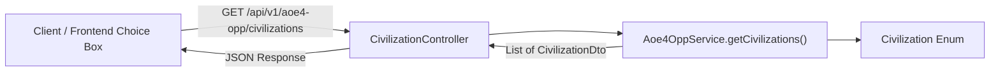

# Requirements

### Overview & Goals
Move the civilization listing endpoint from `PlayerController` into a dedicated `CivilizationController`. This separates domain concerns, improves code organization and modularity, and preserves full backward compatibility for client applications consuming `GET /api/v1/aoe4-opp/civilizations`.

### Scope
- **In Scope:**
  - Creating `CivilizationController` in `com.theboys.aoe.opp.info.controller`.
  - Moving `GET /api/v1/aoe4-opp/civilizations` to `CivilizationController`.
  - Removing the civilizations endpoint from `PlayerController`.
  - Updating `PlayerControllerTest` and adding `CivilizationControllerTest`.
  - Verifying existing `Civilization` enum, `CivilizationDto`, and `Aoe4OppService.getCivilizations()` integration.
- **Out of Scope:**
  - Modifying civilization domain definitions or DTO structures.
  - Changing player search or game analysis endpoints.

### User Stories
- **As a developer / maintainer**, I want civilization-related endpoints grouped in a dedicated `CivilizationController` rather than mixed into `PlayerController` so that the codebase follows single-responsibility principles and is easier to extend with future civilization features.
- **As a client application**, I want `GET /api/v1/aoe4-opp/civilizations` to return the same structured list of civilizations without breaking contract changes.

### Functional Requirements
1. **Endpoint**: `GET /api/v1/aoe4-opp/civilizations`
2. **Controller**: `CivilizationController` annotated with `@RestController`, `@RequiredArgsConstructor`, and `@RequestMapping("/api/v1/aoe4-opp/civilizations")` (or `@RequestMapping("/api/v1/aoe4-opp")`).
3. **Response Structure**: Return `List<CivilizationDto>` (sorted alphabetically by display name) with HTTP 200 OK:
   ```json
   [
     {
       "value": "abbasid_dynasty",
       "displayName": "Abbasid Dynasty"
     },
     {
       "value": "ayyubids",
       "displayName": "Ayyubids"
     }
   ]
   ```
4. **Clean PlayerController**: `PlayerController` no longer contains civilization retrieval methods or endpoints.

# Technical Design

### Current Implementation
- `PlayerController` currently exposes `GET /api/v1/aoe4-opp/civilizations` alongside player endpoints (`/player/{playerId}/game-info`, `/player/{playerId}/games`, `/player/search`).
- `Aoe4OppService` provides `getCivilizations()` which maps and sorts `Civilization.values()` into `List<CivilizationDto>`.
- `Civilization` and `CivilizationDto` define the domain model and response contract.

### Key Decisions
- **Dedicated Controller (`CivilizationController`)**: Extract civilization endpoints into `com.theboys.aoe.opp.info.controller.CivilizationController`. This ensures controllers are organized cleanly by domain responsibility.
- **Preserve Endpoint URL Route**: Maintain `GET /api/v1/aoe4-opp/civilizations` (mapping `@RequestMapping("/api/v1/aoe4-opp/civilizations")` with `@GetMapping` or `@RequestMapping("/api/v1/aoe4-opp")` with `@GetMapping("/civilizations")`) to ensure zero disruption to frontend clients.
- **Reuse `Aoe4OppService.getCivilizations()`**: Inject `Aoe4OppService` into `CivilizationController` to leverage the existing tested data transformation logic without redundant refactoring.

### Data Models / Contracts

#### `CivilizationController` (`com.theboys.aoe.opp.info.controller`)
```java
@RequestMapping("/api/v1/aoe4-opp/civilizations")
@RestController
@RequiredArgsConstructor
public class CivilizationController {

    private final Aoe4OppService aoe4OppService;

    @GetMapping
    public List<CivilizationDto> getCivilizations() {
        return aoe4OppService.getCivilizations();
    }
}
```

### Architecture Diagram


### File Structure
- `src/main/java/com/theboys/aoe/opp/info/controller/CivilizationController.java` (New)
- `src/main/java/com/theboys/aoe/opp/info/controller/PlayerController.java` (Modified - remove civilization endpoint)
- `src/test/java/com/theboys/aoe/opp/info/controller/CivilizationControllerTest.java` (New)
- `src/test/java/com/theboys/aoe/opp/info/controller/PlayerControllerTest.java` (Modified - remove civilization test)

### Risks & Mitigations
- **Route Mismatch / Breaking Frontend Clients**: Ensured by mapping `GET /api/v1/aoe4-opp/civilizations` on `CivilizationController` so the public URL path remains identical.

# Testing

### Validation Approach
Verify endpoint routing, HTTP status codes, service delegation, and JSON payload consistency using JUnit 5 and Mockito.

### Key Scenarios
1. **CivilizationController Endpoint Retrieval**:
   - Send `GET /api/v1/aoe4-opp/civilizations`.
   - Verify `Aoe4OppService.getCivilizations()` is invoked.
   - Assert HTTP 200 OK and valid `List<CivilizationDto>` returned.
2. **PlayerController Regression Verification**:
   - Verify player endpoints (`game-info`, `games`, `search`) continue to function without regression.
   - Ensure `PlayerController` no longer exposes `/civilizations`.

### Test Changes
- `src/test/java/com/theboys/aoe/opp/info/controller/CivilizationControllerTest.java` — unit test for `CivilizationController.getCivilizations()`.
- `src/test/java/com/theboys/aoe/opp/info/controller/PlayerControllerTest.java` — remove civilization test case, retaining player-related tests.

# Delivery Steps

### ✓ Step 1: Create CivilizationController and clean up PlayerController
Create the dedicated controller for civilizations and remove civilization endpoints from PlayerController.

- Create `CivilizationController` in `com.theboys.aoe.opp.info.controller` mapped to `/api/v1/aoe4-opp/civilizations`.
- Inject `Aoe4OppService` and expose `getCivilizations()` endpoint.
- Remove `getCivilizations()` and associated imports from `PlayerController`.

### ✓ Step 2: Implement CivilizationController tests and verify test suite
Ensure comprehensive unit test coverage for the new controller and confirm zero regressions.

- Create `CivilizationControllerTest` verifying `getCivilizations()` routing and mock delegation.
- Remove `testGetCivilizations` from `PlayerControllerTest`.
- Run `./gradlew test` across the entire project to ensure all tests pass.