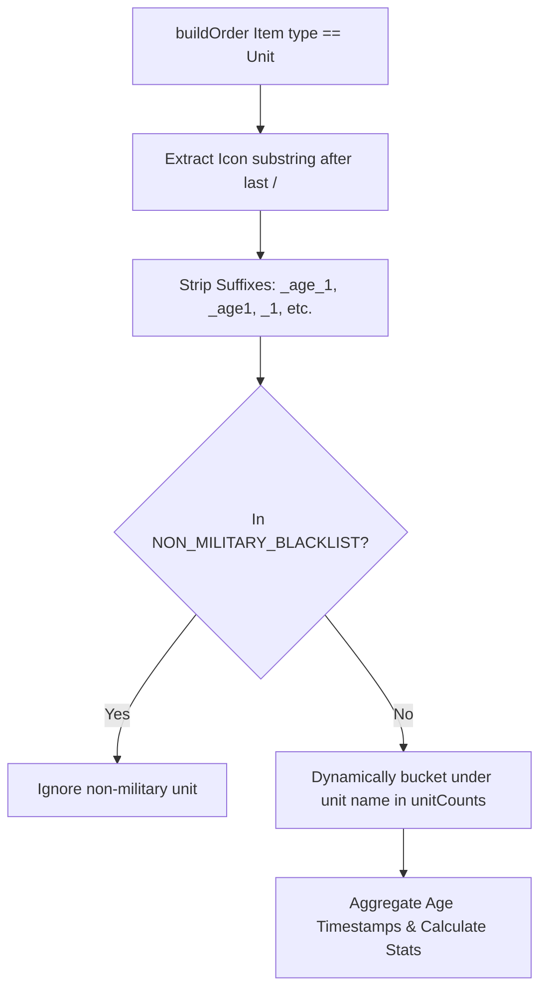

# Requirements

### Overview & Goals
Transition military unit tracking in `PlayerSummaryAnalysisService` from a static whitelist with substring matching (`TRACKED_MILITARY_UNITS`) to dynamic unit bucketing using icon path parsing, suffix stripping, and a non-military blacklist. This resolves unit misclassification issues (such as `hospitaller_knight_age_2` being incorrectly categorized as `knight`).

### Scope
- **In Scope**:
  - Extract unit identifier by taking the substring after the last `/` from the unit's icon path (e.g., `icons/races/templar/units/hospitaller_knight_age_2` -> `hospitaller_knight_age_2`).
  - Strip known version/age suffixes from the extracted unit string: `"_1"`, `"_2"`, `"_3"`, `"_4"`, `"_age1"`, `"_age2"`, `"_age3"`, `"_age4"`, `"_age_1"`, `"_age_2"`, `"_age_3"`, `"_age_4"`.
  - Maintain a non-military blacklist containing non-combat units, civilians, eco units, and heroes/religious units specified by the issue.
  - Dynamically bucket any unit not in the blacklist into the military summary results.
  - Maintain existing calculation rules (average per age, total average, percentage of total) and sorting criteria.
  - Comprehensive unit tests covering hospitaller knight, suffix stripping variants, and blacklist filtering.
- **Out of Scope**:
  - Changes to villager, trader, town center, APM, or landmark calculation algorithms.
  - Changes to REST controller endpoints or external DTO structures.

### User Stories
- **As an AoE IV match analyst / API consumer**, I want specific civilization military units (like Knights Templar `hospitaller_knight`) to be reported under their true unit name rather than generic base units (`knight`), so that unit composition statistics accurately reflect player army choices.
- **As a maintainer**, I want new military unit types to be supported automatically without needing manual whitelist updates, managing only a compact non-military blacklist for exclusions.

### Functional Requirements
- **Icon Path Extraction**:
  - Given an icon path like `icons/races/templar/units/hospitaller_knight_age_2`, extract the substring after the last `/`.
  - If no `/` is present, use the full icon string.
  - Normalize to lowercase and trim whitespace.
- **Suffix Removal**:
  - Remove trailing suffixes if present: `"_1"`, `"_2"`, `"_3"`, `"_4"`, `"_age1"`, `"_age2"`, `"_age3"`, `"_age4"`, `"_age_1"`, `"_age_2"`, `"_age_3"`, `"_age_4"`.
  - Check longer suffixes first (e.g., `_age_1` before `_1`) to prevent partial stripping.
- **Blacklist Matching**:
  - Check normalized unit name against `NON_MILITARY_BLACKLIST`.
  - Blacklist items: `"villager"`, `"scout"`, `"monk"`, `"buddhist_monk"`, `"mounted_villager"`, `"mehter"`, `"dervish"`, `"unit_khan_1_mon"`, `"shinto_priest"`, `"general_ship"`, `"jeanne_villager"`, `"jeanne_archer"`, `"horseman_grassland"`, `"shaolin_monk"`, `"jeanne_ranged_monarch"`, `"imperial_official"`, `"jeanne_manatarms"`, `"transport"`, `"trade_ship"`, `"trade_cart"`, `"fishing_boat"`, `"camel_trader"`, `"yatai"`, `"cattle"`, `"reindeer_trader"`, `"emissary"`, `"fortress"`, `"treasure_caravan"`, `"jeanne_melee_monarch"`, `"jeanne_melee_knight"`, `"pilgrim"`.
  - If matched in blacklist, ignore unit for military summary.
- **Dynamic Bucketing**:
  - If not in blacklist, dynamically record unit counts across game ages.
  - Omit units with 0 total production across analyzed games.
  - Calculate percentage of total military and age averages.
  - Sort military summaries by `percentageOfTotal` descending, then `averageCount` descending, then `unitType` ascending.

# Technical Design

### Current Implementation
In `PlayerSummaryAnalysisService.java`, military unit tracking uses a static list `TRACKED_MILITARY_UNITS` and `matchMilitaryUnitType(String icon)` with `icon.contains(unitType)`.
- If an icon string is `icons/races/templar/units/hospitaller_knight_age_2`, `icon.contains("knight")` matches true before `hospitaller_knight` is checked or considered.
- Substring matching creates ordering races and misattributes specialized units to base unit categories.

### Key Decisions
1. **Dynamic Bucketing with Blacklist**:
   - *Chosen Approach*: Maintain a `Set<String> NON_MILITARY_BLACKLIST` and dynamically bucket any non-blacklisted unit name extracted from `buildOrder` items where `type == "Unit"`.
   - *Rationale*: Non-military units are far less numerous and change rarely, whereas new civilizations and variants frequently introduce new military units.
2. **Suffix Stripping Strategy**:
   - *Chosen Approach*: Evaluate suffixes ordered by descending length (`_age_1`, `_age_2`, `_age_3`, `_age_4`, `_age1`, `_age2`, `_age3`, `_age4`, `_age_`, `_1`, `_2`, `_3`, `_4`).
   - *Rationale*: Prevents `_age_1` from having only `_1` removed resulting in an invalid trailing `_age_`.
3. **Extraction Order**:
   - Extract last segment after `/` -> normalize lowercase -> strip suffix -> compare against blacklist -> dynamically bucket.

### Architecture Diagram


### Proposed Changes
- **`PlayerSummaryAnalysisService.java`**:
  - Remove `TRACKED_MILITARY_UNITS` and `matchMilitaryUnitType(icon)`.
  - Introduce `NON_MILITARY_BLACKLIST = Set.of(...)` containing the 31 blacklisted units.
  - Introduce `UNIT_SUFFIXES = List.of(...)` sorted longest-to-shortest.
  - Add `extractMilitaryUnitName(String icon)` helper method.
  - Update `calculateMilitarySummary(...)`:
    - Initialize dynamic `Map<String, double[]> unitCounts = new LinkedHashMap<>()`.
    - Extract unit name using `extractMilitaryUnitName(icon)`.
    - Bucket production timestamps per age using `unitCounts.computeIfAbsent(unitName, k -> new double[4])`.
    - Iterate `unitCounts.entrySet()` to compute totals, averages, and percentages.
    - Retain existing sorting comparator.

### Data Models / Contracts
No changes to external DTOs (`MilitaryUnitSummaryDto`, `PlayerSummaryDto`).
Contract for internal unit extraction:
```java
private static final Set<String> NON_MILITARY_BLACKLIST = Set.of(
    "villager", "scout", "monk", "buddhist_monk", "mounted_villager",
    "mehter", "dervish", "unit_khan_1_mon", "shinto_priest", "general_ship",
    "jeanne_villager", "jeanne_archer", "horseman_grassland", "shaolin_monk",
    "jeanne_ranged_monarch", "imperial_official", "jeanne_manatarms", "transport",
    "trade_ship", "trade_cart", "fishing_boat", "camel_trader", "yatai",
    "cattle", "reindeer_trader", "emissary", "fortress", "treasure_caravan",
    "jeanne_melee_monarch", "jeanne_melee_knight", "pilgrim"
);

private static final List<String> UNIT_SUFFIXES = List.of(
    "_age_1", "_age_2", "_age_3", "_age_4",
    "_age1", "_age2", "_age3", "_age4",
    "_1", "_2", "_3", "_4"
);

private String extractMilitaryUnitName(final String icon);
```

### Risks & Mitigations
- **Risk**: A newly introduced non-combat unit or neutral entity could be bucketed as military.
  - *Mitigation*: The blacklist approach allows easy updates by adding the unit name to `NON_MILITARY_BLACKLIST`.
- **Risk**: Icons without `/` or with uppercase letters.
  - *Mitigation*: Handle null/empty gracefully, fallback to full string if no `/`, and normalize to lowercase.

# Testing

### Validation Approach
Verify via automated unit tests using JUnit 5 and Mockito in `PlayerSummaryAnalysisServiceTest.java`. Ensure all existing match analysis tests pass and add dedicated test cases for the new icon parsing and blacklist behavior.

### Key Scenarios
1. **Templar Hospitaller Knight Unit**:
   - Input: buildOrder item with `icons/races/templar/units/hospitaller_knight_age_2` alongside standard `icons/races/common/units/knight`.
   - Expected Output: Military summary contains two distinct unit buckets: `hospitaller_knight` and `knight`.
2. **Suffix Stripping**:
   - Input: unit icons with various suffix formats (`_1`, `_age2`, `_age_3`, etc., e.g., `icons/races/hre/units/spearman_age_2`, `icons/races/english/units/longbowman_age1`, `icons/races/mongols/units/mangudai_1`).
   - Expected Output: Units stripped and normalized to `spearman`, `longbowman`, `mangudai`.
3. **Blacklist Filtering**:
   - Input: buildOrder items with icons for `villager`, `scout`, `monk`, `trade_cart`, `fishing_boat`, `unit_khan_1_mon`, `jeanne_villager`.
   - Expected Output: None of these appear in `militaryProduction` list.
4. **Existing Match Fixtures**:
   - Run full regression suite on existing match summary test fixtures to verify calculation accuracy across all existing samples.

### Edge Cases
- Icon path without `/` (e.g. `archer_age_2` -> `archer`).
- Blank / null icon strings (safely ignored, no exceptions).
- Units with name containing suffix letters elsewhere (e.g. `unit_khan_1_mon` remains `unit_khan_1_mon` and matches blacklist).

# Delivery Steps

### ✓ Step 1: Implement icon parsing, suffix stripping, and blacklist filtering
Implement the extraction of unit identifiers from icon paths, suffix stripping for age/version tags, and the non-military blacklist in `PlayerSummaryAnalysisService.java`.

- Define constant `NON_MILITARY_BLACKLIST` containing all excluded non-military unit types (`villager`, `scout`, `monk`, `trade_cart`, etc.) in a `Set<String>`.
- Define constant `UNIT_SUFFIXES` ordered by length descending (`_age_1`, `_age_2`, `_age_3`, `_age_4`, `_age1`, `_age2`, `_age3`, `_age4`, `_1`, `_2`, `_3`, `_4`).
- Implement helper method `extractMilitaryUnitName(String icon)` that extracts the substring after the last `/`, converts to lowercase, trims whitespace, strips matched trailing suffixes, and verifies the name is not in the blacklist.

### ✓ Step 2: Refactor military summary calculation and update unit tests
Update `calculateMilitarySummary` to dynamically bucket military units by their extracted name and add comprehensive unit test coverage.

- Replace static iteration over `TRACKED_MILITARY_UNITS` in `calculateMilitarySummary` with dynamic `Map<String, double[]>` bucketing populated on the fly for non-blacklisted units.
- Remove obsolete `TRACKED_MILITARY_UNITS` and `matchMilitaryUnitType` methods.
- Preserve overall military unit percentage calculations and sorting (percentage descending, average count descending, unit name ascending).
- Add unit tests in `PlayerSummaryAnalysisServiceTest.java` covering hospitaller knights, variant suffixes (`_age_2`, `_1`, etc.), blacklist filtering (`villager`, `scout`, `trade_cart`), and ensure all existing player summary tests pass.