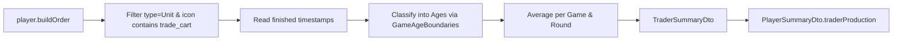

# Requirements

### Overview & Goals
Extend the matchup and player summary analysis to track Trader production across match ages. Similar to how `villagerProduction` is analyzed and exposed via `VillagerSummaryDto`, traders (represented by `icons/races/common/units/trade_cart` in AOE4World build orders) provide key strategic insight into whether an opponent invests in trade and in which age.

### Scope
- **In Scope**:
  - Creating `TraderSummaryDto` in `com.theboys.aoe.opp.info.dto` with age breakdown (`darkAge`, `feudalAge`, `castleAge`, `imperialAge`, `total`).
  - Adding `traderProduction` field of type `TraderSummaryDto` to `PlayerSummaryDto`.
  - Updating `PlayerSummaryAnalysisService` to extract finished trade cart units matching `icons/races/common/units/trade_cart` / `trade_cart` keyword and calculate per-age averages and total averages.
  - Adding unit test cases in `PlayerSummaryAnalysisServiceTest` to validate trader extraction across multiple ages and edge cases.
- **Out of Scope**:
  - Changing military unit categorization or APM / landmark calculations.
  - Scraping changes or database schema changes (summary data is stored as jsonb and dynamically parsed).

### User Stories
- As an Age of Empires IV player/analyst, I want to see how many traders an opponent produces on average per age so that I can anticipate trade-based economic booms and prepare counter-strategies.

### Functional Requirements
1. **Trader Data Model (`TraderSummaryDto`)**:
   - Must contain `darkAge`, `feudalAge`, `castleAge`, `imperialAge`, and `total` (all `Double` values representing average unit counts rounded to 2 decimal places).
2. **Player Summary Exposure**:
   - `PlayerSummaryDto` must include `private TraderSummaryDto traderProduction;`.
3. **Build Order Extraction & Age Binning**:
   - In `PlayerSummaryAnalysisService`, inspect player `buildOrder` items where `type` is `"Unit"` and `icon` contains `icons/races/common/units/trade_cart` or `trade_cart`.
   - For every timestamp in the item's `finished` array, assign the unit to Dark, Feudal, Castle, or Imperial age using the game's age transition boundaries.
   - Calculate average counts per game across all analyzed matches and round to 2 decimal places.
4. **Resilience & Fallbacks**:
   - If a player builds no traders or `buildOrder` is missing/empty, return a `TraderSummaryDto` with `0.0` for all ages and total.

### Non-Functional Requirements
- Follow project coding standards: explicit types, `final` modifiers on all variables and parameters, immutability, Lombok `@Builder(setterPrefix = "with")`, and no magic strings.

# Technical Design

### Current Implementation
In `PlayerSummaryAnalysisService`:
- `calculateVillagerSummary` iterates over `buildOrder` events, checks `UNIT_TYPE.equalsIgnoreCase(type) && icon.contains(VILLAGER_KEYWORD)`, and increments counts for each age based on `boundaries.determineAge(time)` from the `finished` array.
- `PlayerSummaryDto` exposes `villagerProduction`, `militaryProduction`, `additionalTownCenters`, `landmarks`, and `ageUpTimings`.

### Key Decisions
1. **Model Structure**:
   - Mirror `VillagerSummaryDto` and `TownCenterSummaryDto` by defining `TraderSummaryDto` with `darkAge`, `feudalAge`, `castleAge`, `imperialAge`, and `total`.
2. **Field Naming**:
   - Name the property in `PlayerSummaryDto` as `traderProduction` to remain consistent with `villagerProduction` and `militaryProduction`.
3. **Icon & Unit Matching**:
   - Match build order units where `type == "Unit"` and `icon` contains `trade_cart` (case-insensitive) or matches `icons/races/common/units/trade_cart`.

### Proposed Changes
1. **`TraderSummaryDto.java`**:
   - Create new DTO class in package `com.theboys.aoe.opp.info.dto`.
2. **`PlayerSummaryDto.java`**:
   - Add field `private TraderSummaryDto traderProduction;`.
3. **`PlayerSummaryAnalysisService.java`**:
   - Define constant `TRADE_CART_KEYWORD = "trade_cart"`.
   - Add `calculateTraderSummary(List<JsonNode> playerNodes, int totalGames)`.
   - Update `analyzePlayerSummaries` to call `calculateTraderSummary` and populate `PlayerSummaryDto.withTraderProduction(...)`.

### Data Models / Contracts

```java
package com.theboys.aoe.opp.info.dto;

import com.fasterxml.jackson.annotation.JsonIgnoreProperties;
import lombok.AllArgsConstructor;
import lombok.Builder;
import lombok.Getter;
import lombok.NoArgsConstructor;
import lombok.Setter;

@Getter
@Setter
@Builder(setterPrefix = "with")
@NoArgsConstructor
@AllArgsConstructor
@JsonIgnoreProperties(ignoreUnknown = true)
public class TraderSummaryDto {
    private Double darkAge;
    private Double feudalAge;
    private Double castleAge;
    private Double imperialAge;
    private Double total;
}
```

### File Structure
- Added:
  - `src/main/java/com/theboys/aoe/opp/info/dto/TraderSummaryDto.java`
- Modified:
  - `src/main/java/com/theboys/aoe/opp/info/dto/PlayerSummaryDto.java`
  - `src/main/java/com/theboys/aoe/opp/info/service/PlayerSummaryAnalysisService.java`
- Tests Modified:
  - `src/test/java/com/theboys/aoe/opp/info/service/PlayerSummaryAnalysisServiceTest.java`

### Architecture Diagram


### Risks
- **Risk**: Trade carts might be produced from unique civilization landmarks (e.g. Mongol Silver Tree or Ayyubid Bazaar) with differing icon names.
  - **Mitigation**: Using substring matching `trade_cart` handles standard trade carts across civilizations (`icons/races/common/units/trade_cart`) as well as civilization-specific trade cart variants.

# Testing

### Validation Approach
Verify trader analysis logic with automated JUnit 5 unit tests in `PlayerSummaryAnalysisServiceTest` covering single-game scenarios, multi-game aggregation, age transitions, and edge cases.

### Key Scenarios
1. **Single Game Trader Production**:
   - Build order with 2 Dark Age traders, 5 Feudal Age traders, 3 Castle Age traders, and 1 Imperial Age trader.
   - Verify `TraderSummaryDto` contains `darkAge: 2.0`, `feudalAge: 5.0`, `castleAge: 3.0`, `imperialAge: 1.0`, and `total: 11.0`.
2. **Multi-Game Averaging**:
   - Analyze two games where Player A produced 10 Feudal traders in Game 1 and 0 traders in Game 2.
   - Verify `feudalAge: 5.0` and `total: 5.0`.
3. **No Traders Produced**:
   - Analyze games where no trade carts were built.
   - Verify `TraderSummaryDto` returns `0.0` for all ages and total.

### Edge Cases
- Missing or non-array `buildOrder` node.
- Build order items with `trade_cart` icon but empty or missing `finished` array.
- Case-insensitivity verification for icon paths (e.g., `icons/races/common/units/trade_cart`).

# Delivery Steps

### ✓ Step 1: Create TraderSummaryDto and Update PlayerSummaryDto
Create the `TraderSummaryDto` model and add `traderProduction` to `PlayerSummaryDto`.

- Create `TraderSummaryDto.java` in package `com.theboys.aoe.opp.info.dto` with fields `darkAge`, `feudalAge`, `castleAge`, `imperialAge`, and `total` (all `Double`), annotated with Lombok `@Getter`, `@Setter`, `@Builder(setterPrefix = "with")`, `@NoArgsConstructor`, `@AllArgsConstructor`, and Jackson `@JsonIgnoreProperties(ignoreUnknown = true)`.
- Add `private TraderSummaryDto traderProduction;` to `PlayerSummaryDto.java` along with appropriate Lombok builder integration.

### ✓ Step 2: Implement Trader Summary Calculation in PlayerSummaryAnalysisService
`PlayerSummaryAnalysisService` extracts trade cart units from build orders and aggregates average counts per age and overall total.

- Add constant `TRADE_CART_KEYWORD = "trade_cart"` and support for `icons/races/common/units/trade_cart` in `PlayerSummaryAnalysisService.java`.
- Implement private method `calculateTraderSummary(final List<JsonNode> playerNodes, final int totalGames)` to iterate through player `buildOrder` items, filter on `type == "Unit"` and `icon` matching trade carts, extract `finished` timestamps, classify them into Dark, Feudal, Castle, and Imperial ages using `GameAgeBoundaries`, and compute rounded averages across `totalGames`.
- Wire `calculateTraderSummary` into `analyzePlayerSummaries` and pass `traderProduction` into `PlayerSummaryDto.builder()`.

### ✓ Step 3: Add Unit Tests and Validate Analysis Pipeline
Unit test suite verifies trader extraction, age-binning, multi-game averaging, and zero/empty handling.

- Add unit test cases in `PlayerSummaryAnalysisServiceTest.java` verifying single-game and multi-game trader counts across Dark, Feudal, Castle, and Imperial ages.
- Add test coverage for players with zero trade carts, missing `buildOrder`, and various icon representations (e.g. `icons/races/common/units/trade_cart`).
- Run the full test suite (`./gradlew test`) to verify zero regressions.